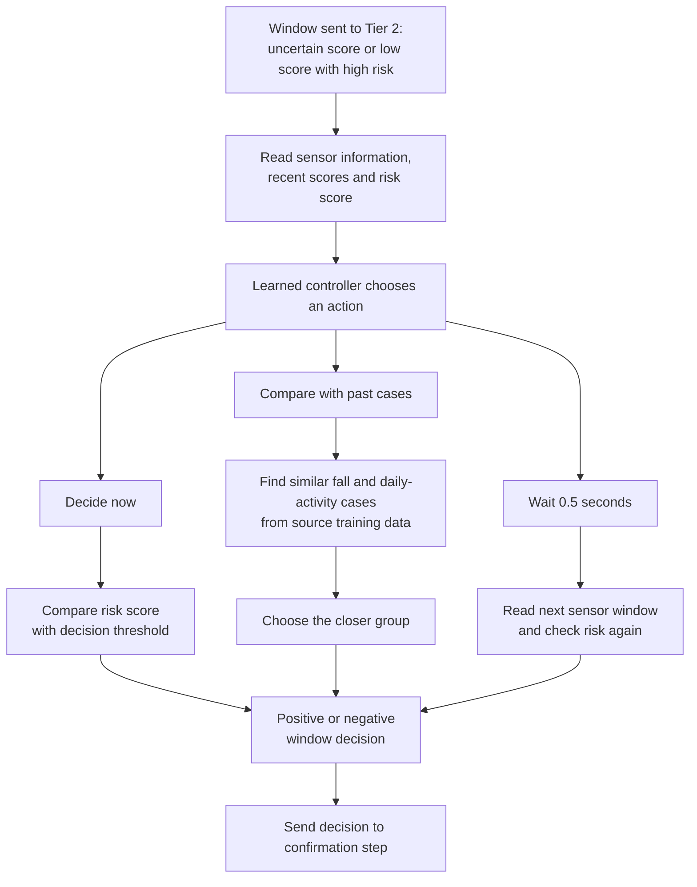

# Fall Detection: Results Tables

| Current specialist-free Tier 1 + Tier 2 | Recordings | Accuracy | Precision | Recall | F1 | Specificity | ADL alarms/hour |
|---|---:|---:|---:|---:|---:|---:|---:|
| MobiFall | 630 | 55.71% | 51.01% | 79.17% | 62.04% | 35.96% | 139.04 |
| UP-Fall | 559 | 83.18% | 77.66% | 88.63% | 82.78% | 78.62% | 35.74 |
| EVIORA-HAR | 1,950 | 93.08% | 82.34% | 83.80% | 83.06% | 95.43% | 16.21 |
| KFall | Source development | Not available | — | — | — | — | — |
| SisFall | Source development | Not available | — | — | — | — | — |

| Dataset | Method | Accuracy | Precision | Recall | F1 | Specificity |
|---|---|---:|---:|---:|---:|---:|
| MobiFall | Tier 1 only | 51.59% | 47.40% | 53.82% | 50.41% | 49.71% |
| MobiFall | Fixed numerical review | 57.46% | 52.18% | 82.99% | 64.08% | 35.96% |
| MobiFall | Learned Tier 2 | 55.71% | 51.01% | 79.17% | 62.04% | 35.96% |
| UP-Fall | Tier 1 only | 81.22% | 78.85% | 80.39% | 79.61% | 81.91% |
| UP-Fall | Fixed numerical review | 82.65% | 75.99% | 90.59% | 82.65% | 75.99% |
| UP-Fall | Learned Tier 2 | 83.18% | 77.66% | 88.63% | 82.78% | 78.62% |
| EVIORA-HAR | Tier 1 only | 90.82% | 93.20% | 58.99% | 72.25% | 98.91% |
| EVIORA-HAR | Fixed numerical review | 94.51% | 82.88% | 91.90% | 87.15% | 95.18% |
| EVIORA-HAR | Learned Tier 2 | 93.08% | 82.34% | 83.80% | 83.06% | 95.43% |

| Current learned Tier 2 | True positives | False negatives | False positives | True negatives | Correct / total |
|---|---:|---:|---:|---:|---:|
| MobiFall | 228 | 60 | 219 | 123 | 351 / 630 |
| UP-Fall | 226 | 29 | 65 | 239 | 465 / 559 |
| EVIORA-HAR | 331 | 64 | 71 | 1,484 | 1,815 / 1,950 |

| Current learned Tier 2 | ADL alarm edges | ADL hours | ADL alarms/hour | Tier 2 interventions | Recordings with Tier 2 intervention |
|---|---:|---:|---:|---:|---:|
| MobiFall | 325 | 2.34 | 139.04 | 4,706 | 374 / 630 (59.37%) |
| UP-Fall | 133 | 3.72 | 35.74 | 711 | 139 / 559 (24.87%) |
| EVIORA-HAR | 74 | 4.56 | 16.21 | 658 | 338 / 1,950 (17.33%) |

## Earlier five-fold full-system results: KFall and SisFall

| Dataset | Method | Eligible recordings | TP | FN | FP | TN | Accuracy | Precision | Recall | F1 | Specificity |
|---|---|---:|---:|---:|---:|---:|---:|---:|---:|---:|---:|
| KFall | Tier 1 only | 5,070 | 2,328 | 13 | 9 | 2,720 | 99.57% | 99.61% | 99.44% | 99.53% | 99.67% |
| KFall | Fixed confidence gate | 5,070 | 2,332 | 9 | 10 | 2,719 | 99.63% | 99.57% | 99.62% | 99.59% | 99.63% |
| KFall | Fixed one-hop wait | 5,070 | 2,330 | 11 | 10 | 2,719 | 99.59% | 99.57% | 99.53% | 99.55% | 99.63% |
| KFall | Learned controller | 5,070 | 2,333 | 8 | 11 | 2,718 | 99.63% | 99.53% | 99.66% | 99.59% | 99.60% |
| SisFall | Tier 1 only | 4,500 | 1,747 | 51 | 15 | 2,687 | 98.53% | 99.15% | 97.16% | 98.15% | 99.44% |
| SisFall | Fixed confidence gate | 4,500 | 1,762 | 36 | 21 | 2,681 | 98.73% | 98.82% | 98.00% | 98.41% | 99.22% |
| SisFall | Fixed one-hop wait | 4,500 | 1,747 | 51 | 18 | 2,684 | 98.47% | 98.98% | 97.16% | 98.06% | 99.33% |
| SisFall | Learned controller | 4,500 | 1,762 | 36 | 19 | 2,683 | 98.78% | 98.93% | 98.00% | 98.46% | 99.30% |

| Earlier system endpoint | Definition |
|---|---|
| KFall | A fall is a true positive only if matched in the annotated onset-to-impact-plus-two-seconds interval; an ADL recording is false positive if it has at least one alarm edge. Five fall recordings without an eligible matching endpoint are excluded; 5,070 of 5,075 recordings remain. |
| SisFall | A fall trial is a true positive if an alarm occurs anywhere in the trial; an ADL recording is false positive if it has at least one alarm edge. All 4,500 retained recordings are included. |
| Provenance | Computed from saved five-fold per-recording outcomes. The earlier controller includes a CNN–LSTM specialist and is different from the current specialist-free system. These are mixed event/recording endpoints for KFall, not ordinary whole-recording classification. Results are exploratory. |

## Earlier learned controller: per-fold results

| Dataset | Fold | Eligible recordings | Accuracy | Precision | Recall | F1 | Specificity |
|---|---:|---:|---:|---:|---:|---:|---:|
| KFall | 0 | 958 | 99.58% | 99.77% | 99.32% | 99.55% | 99.81% |
| KFall | 1 | 957 | 100.00% | 100.00% | 100.00% | 100.00% | 100.00% |
| KFall | 2 | 957 | 99.69% | 100.00% | 99.33% | 99.66% | 100.00% |
| KFall | 3 | 1,102 | 99.36% | 98.82% | 99.80% | 99.31% | 99.00% |
| KFall | 4 | 1,096 | 99.54% | 99.23% | 99.81% | 99.52% | 99.31% |
| SisFall | 0 | 946 | 99.79% | 99.73% | 99.73% | 99.73% | 99.82% |
| SisFall | 1 | 942 | 99.68% | 100.00% | 99.20% | 99.60% | 100.00% |
| SisFall | 2 | 946 | 97.89% | 99.44% | 95.20% | 97.28% | 99.65% |
| SisFall | 3 | 932 | 98.71% | 97.13% | 99.73% | 98.41% | 98.03% |
| SisFall | 4 | 734 | 97.55% | 98.29% | 95.67% | 96.96% | 98.85% |

## Earlier gated-retrieval classification experiments: separate tasks

| Dataset | Evaluation task | Recordings | Accuracy | F1 | Recall | Specificity |
|---|---|---:|---:|---:|---:|---:|
| KFall | Impact-selected fall windows and separately selected ADL windows; gated retrieval | 5,075 | 99.63% | 99.59% | 99.53% | 99.71% |
| SisFall | Nine-second trial-prefix classification; corrected gated retrieval | 4,500 | 97.00% | 96.14% | 93.49% | 99.33% |

| Classification qualification | Details |
|---|---|
| KFall | The fall label and impact annotation were used to select fall windows; this is not streaming detection accuracy. |
| Comparison | Classification experiments use separately fitted models and differ from both the earlier sequential controller and the current specialist-free shared model. |
| Sources | [Earlier sequential controller report](../results/isolated_escalation_20261119_134528/unified_controller/REPORT.md); [per-recording KFall](../results/isolated_escalation_20261119_134528/unified_controller/kfall_recordings.json); [per-recording SisFall](../results/isolated_escalation_20261119_134528/unified_controller/sisfall_recordings.json); [classification results](SISFALL_KFALL_RESULTS_FOR_PAPER.md). |

| Evaluation qualification | Result |
|---|---|
| Current external results | Recording-level; an alarm anywhere in a fall recording counts as detection. |
| EVIORA-HAR coverage | 1,950 of 1,954 identified recordings included; four had insufficient usable sensor data. |
| Earlier KFall result | Timed event-matching endpoint. |
| Earlier SisFall result | Whole-trial endpoint; an alarm before the fall can count. |
| Architecture comparison | Earlier KFall/SisFall results and current specialist-free results use different architectures and evaluation endpoints. |

## Current Tier 2: how it makes a decision

Tier 2 receives a window when the Tier 1 score is **uncertain**, or when the Tier 1 score is low but the separate risk score is high. It uses the current sensor information and recent detector scores to choose one of three actions:

- **Decide now:** compare the risk score with a decision threshold.
- **Compare past cases:** look at similar fall and daily-activity examples from the source training data, then choose the closer group.
- **Wait:** look at the next sensor window, 0.5 seconds later, and check the risk again. It waits at most one hop for that decision.

A positive window is not automatically an alarm: the current system requires **two consecutive positive windows** for confirmation. Past cases come from source training subjects, not the external test recordings. The diagram describes the current specialist-free system; it does not describe the earlier CNN–LSTM specialist system.
